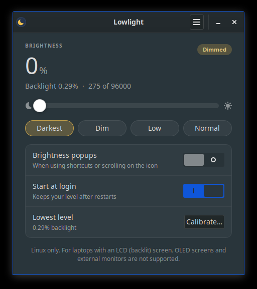
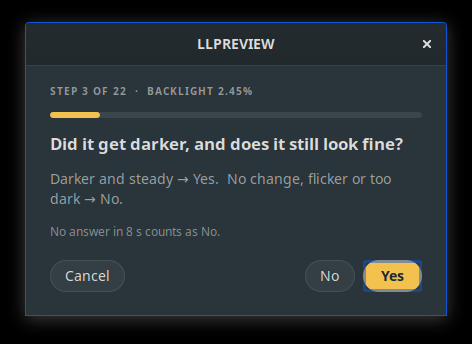

# Lowlight

**Dim your laptop screen below the normal minimum brightness.**

Your desktop's brightness slider usually stops well above what the
hardware can do. Lowlight lowers the real backlight further. That makes
the screen comfortable in a dark room, and because the backlight uses
less power, it also saves battery.

> **Linux only.** Lowlight works on **laptops with an LCD (backlit)
> screen**. It does **not** work with:
> - **OLED screens**, which have no backlight;
> - **desktop PCs and external monitors**, since their brightness isn't
>   controlled through the laptop backlight.

<p align="center">
  
  
</p>

## Features

- A **tray icon** in your panel:
  - **left click** opens the window;
  - **right click** opens the menu (darker, brighter, restore, calibrate,
    About, Quit);
  - **scroll** over the icon changes the brightness.
- A **slider** that covers the whole range, from full brightness down to
  the lowest level your screen can show, with one-click presets
  (Darkest, Dim, Low, Normal).
- A clean window that follows your **light or dark theme**.
- **Calibration** finds the lowest level that still looks good on your
  screen.
- **Keyboard shortcuts**, plus an optional on-screen popup that shows the
  level.
- **Remembers your level** after suspend/resume and when you log in.
- **No battery cost while idle.** It waits for events and doesn't poll.
- **Safe for the hardware.** It only sets the backlight to values your
  laptop already supports.
- **Works on X11 and Wayland**, on any desktop.

## Install

### 1. Install the dependencies

Lowlight needs Python 3, PyGObject and GTK 3. Most desktops already have
them. If not, run the command for your distro:

| Distro | Command |
| --- | --- |
| Debian, Ubuntu, Linux Mint, MX Linux, Pop!_OS, elementary OS, Zorin OS, Kali | `sudo apt install python3 python3-gi gir1.2-gtk-3.0` |
| Fedora, Nobara, RHEL, Rocky, AlmaLinux | `sudo dnf install python3 python3-gobject gtk3` |
| Arch, Manjaro, EndeavourOS, Garuda, CachyOS | `sudo pacman -S --needed python python-gobject gtk3` |
| openSUSE Tumbleweed / Leap | `sudo zypper install python3 python3-gobject python3-gobject-Gdk typelib-1_0-Gtk-3_0` |
| Void Linux | `sudo xbps-install -S python3 python3-gobject gtk+3` |
| Gentoo | `sudo emerge --ask dev-python/pygobject x11-libs/gtk+:3` |
| Alpine, postmarketOS | `doas apk add python3 py3-gobject3 gtk+3.0` |
| Other | Install Python 3, PyGObject (`gi`) and the GTK 3 introspection data. |

The installer checks this for you and offers to run the right command.

### 2. Download and run the installer

```sh
git clone https://github.com/ThanosZappas/lowlight.git
cd lowlight
./install.sh
```

No `git`? Click **Code → Download ZIP** on the [project page](https://github.com/ThanosZappas/lowlight), unpack it, open a
terminal in that folder and run `./install.sh`.

The installer:

- puts Lowlight in `~/.local/share/lowlight`, the command in
  `~/.local/bin/lowlight`, and an entry in your app menu;
- checks that it is allowed to change the brightness;
- asks whether to start Lowlight at login;
- asks whether to add keyboard shortcuts (XFCE and GNOME);
- starts Lowlight.

You don't need root unless the installer has to install missing packages
or the udev rule (see below). It asks first.

### 3. Calibrate

Open Lowlight (left click the moon icon, or find it in the app menu) and
click **Calibrate…**. Lowlight lowers the backlight one step at a time and
asks whether the screen got darker and still looks fine. Many screens stop
getting darker at some point; answer **No** there.

If a step turns the screen black, don't do anything. After 8 seconds it
comes back on its own and keeps the last good level.

## Where's the tray icon?

| Desktop | Tray icon |
| --- | --- |
| KDE Plasma, XFCE, Cinnamon, MATE, LXQt, Budgie | Works out of the box |
| Ubuntu (GNOME) | Works out of the box (the AppIndicator extension is preinstalled) |
| GNOME on Fedora, Arch, Debian, etc. | Install the **AppIndicator and KStatusNotifierItem Support** extension |
| Sway, Hyprland, river (Waybar) | Add the `tray` module to Waybar |
| i3, Openbox (X11) | Works with any system tray (i3bar, tint2, stalonetray, ...) |

Without a tray, Lowlight still runs. Open it from the app menu instead.

## Keyboard shortcuts

On **XFCE** and **GNOME**, the installer can add **Super+Alt+Down**
(darker) and **Super+Alt+Up** (brighter) for you. On other desktops, add
them yourself with these commands:

- darker: `lowlight down`
- brighter: `lowlight up`

If a shortcut does nothing, use the full path, `~/.local/bin/lowlight`.

| Desktop | Where |
| --- | --- |
| KDE Plasma | System Settings → Keyboard → Shortcuts → Add New → Command or Script |
| Cinnamon | System Settings → Keyboard → Shortcuts → Add custom shortcut |
| MATE | Control Center → Keyboard Shortcuts → Add |
| Sway / i3 | `bindsym $mod+Mod1+Down exec lowlight down` and `bindsym $mod+Mod1+Up exec lowlight up` |
| Hyprland | `bind = SUPER ALT, down, exec, lowlight down` and `bind = SUPER ALT, up, exec, lowlight up` |

## Command line

```
lowlight              open the window (starts the tray icon too)
lowlight down | up    one step darker / brighter
lowlight set 0-100    set the level (0 = darkest allowed)
lowlight restore      back to the brightness from before dimming
lowlight status       show the backlight values
lowlight calibrate    open calibration
lowlight quit         close the app
```

## No permission to change brightness

Lowlight changes the backlight through **systemd-logind** or **elogind**,
which nearly every distro has, so no root is needed. On systems without
them (some Void, Alpine, Gentoo or Artix setups), the installer offers to
install a udev rule that lets the `video` group change the backlight. To
do it by hand:

```sh
sudo install -m 644 data/90-lowlight-backlight.rules /etc/udev/rules.d/
sudo udevadm control --reload
sudo udevadm trigger --subsystem-match=backlight --action=add
sudo usermod -aG video "$USER"     # then log out and back in
```

## Settings

The window and tray menu cover the common settings. Everything is stored
in `~/.config/lowlight/config.json`:

| Key | Default | Meaning |
| --- | --- | --- |
| `floor` | 1% of max | lowest backlight value (set by calibration) |
| `step` | 0.8 | how much one step changes brightness (smaller = bigger steps) |
| `notify` | true | popup when brightness changes from keys or scrolling |
| `restore_on_login` | true | re-apply your level when you log in |
| `device` | automatic | backlight device name, if your laptop has more than one |

## FAQ

**Can this damage my screen?** No. Lowlight only sets the backlight to
values your laptop's driver accepts. The panel itself decides what the
lowest level really is. Calibration finds that point so the slider
doesn't waste steps below it.

**The screen stopped getting darker below a certain level.** That's
normal. Many panels have a hardware minimum. Run **Calibrate…** and
answer **No** at the first step that isn't darker.

**I see flicker at very low levels.** Some panels dim by switching the
backlight on and off quickly, which is easier to notice at low levels.
Run **Calibrate…** again and answer **No** at the first step that
flickers.

**My Fn brightness keys still work?** Yes. Lowlight reads the real
brightness each time, so you can mix both.

**Why not OLED?** OLED pixels make their own light, so there is no
backlight to lower. OLED laptops would need a different approach that
changes the image itself. That isn't part of Lowlight yet.

## Uninstall

```sh
./uninstall.sh            # keeps your settings
./uninstall.sh --purge    # also deletes ~/.config/lowlight
```

## License

MIT. See [LICENSE](LICENSE).
